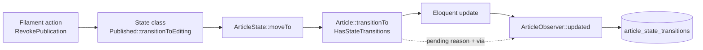
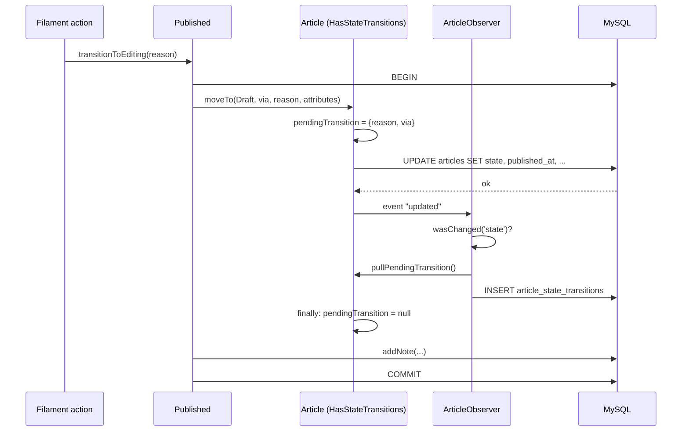
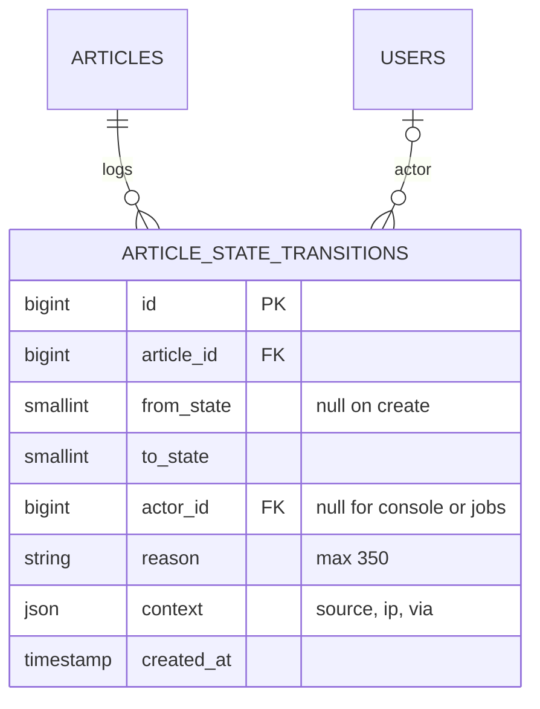

# Article State Transition Log

Every change of `articles.state` is written to an append-only table, `article_state_transitions`, with the previous state, the new state, who did it, why, and which code path triggered it. The log is written by an Eloquent observer inside the same database transaction as the state change, so the two can never diverge.

**Stack:** Laravel 13, PHP 8.5, MySQL, Filament, Livewire
**Status:** implemented

## Contents

1. [Goals and non-goals](#1-goals-and-non-goals)
2. [Architecture](#2-architecture)
3. [Data model](#3-data-model)
4. [Implementation](#4-implementation)
5. [Behavior reference](#5-behavior-reference)
6. [Usage](#6-usage)
7. [Conventions](#7-conventions)
8. [Troubleshooting](#8-troubleshooting)
9. [Testing](#9-testing)
10. [Rollout](#10-rollout)
11. [Design decisions](#11-design-decisions)
12. [Open items](#12-open-items)
## 1. Goals and non-goals

**Goals**

- A complete, ordered history of every state change per article.
- Capture the *why* (reason) and the *how* (code path), not only the *what*.
- Atomic with the state change: no state change without a log row, no log row without a state change.
- One obvious way to change state, so new transitions are logged by default.
- Tamper-resistant: the log cannot be edited or deleted through Eloquent.
**Non-goals**

- Enforcing which transitions are allowed. That stays the job of the state classes in `app/States/Articles/`.
- Auditing columns other than `state`. That is covered by the existing `audits` table.
## 2. Architecture



### Request flow



### Responsibilities

| Component | Location | Responsibility |
| --- | --- | --- |
| `ArticleState` | `app/States/Articles/ArticleState.php` | Base class. `moveTo()` is the single call state classes use to change state. |
| Concrete states (`Published`, `RejectedSuggestion`, ...) | `app/States/Articles/` | Define which transitions exist and what else happens during them. |
| `HasStateTransitions` | `app/Models/Concerns/` | `transitionTo()`, the `stateTransitions()` relation, and the transient reason/via hand-off to the observer. |
| `ArticleObserver` | `app/Observers/` | Detects a real `state` change and writes the log row. |
| `ArticleStateTransition` | `app/Models/` | Append-only log model with enum casts. |
| Migrations | `database/migrations/` | Table creation and a baseline backfill for existing articles. |

## 3. Data model



### Columns

| Column | Type | Notes |
| --- | --- | --- |
| `article_id` | FK to `articles.id` | `cascadeOnDelete`. Soft deletes do not trigger it, only force deletes do. |
| `from_state` | `smallint`, nullable | `null` means the article was just created. Cast to `ArticleStates`. |
| `to_state` | `smallint` | Cast to `ArticleStates`. |
| `actor_id` | FK to `users.id`, nullable | `Auth::id()` at the time of the change. `nullOnDelete`. |
| `reason` | `varchar(350)`, nullable | Same length as `archiving_reason`. |
| `context` | `json`, nullable | `source` (`http` or `console`), `ip`, `via`. Empty values are omitted. |
| `created_at` | `timestamp` | Default `CURRENT_TIMESTAMP`. There is no `updated_at`. |

Index: `(to_state, created_at)` for reporting. `article_id` is indexed by the foreign key.

### Backfill

The second migration inserts one baseline row per existing article (`from_state = null`, `to_state = articles.state`, `context.source = "backfill"`) using a single `INSERT ... SELECT`. History for old articles therefore starts at "state when logging was introduced", not at their real creation.

> [!WARNING]
> The backfill uses MySQL's `JSON_OBJECT()`. It will not run on SQLite, so use a separate test strategy if the test suite runs on SQLite.

## 4. Implementation

### 4.1 `HasStateTransitions`

```php
trait HasStateTransitions
{
    private ?array $pendingTransition = null;

    public function stateTransitions(): HasMany
    {
        return $this->hasMany(ArticleStateTransition::class)->latest('id');
    }

    public function transitionTo(
        ArticleStates $to,
        ?string $reason = null,
        array $attributes = [],
        ?string $via = null,
    ): bool {
        return DB::transaction(function () use ($to, $reason, $attributes, $via): bool {
            $this->pendingTransition = ['reason' => $reason, 'via' => $via];

            try {
                return $this->update(['state' => $to] + $attributes);
            } finally {
                $this->pendingTransition = null;
            }
        });
    }

    public function pullPendingTransition(): array
    {
        $pending = $this->pendingTransition ?? ['reason' => null, 'via' => null];
        $this->pendingTransition = null;

        return $pending;
    }
}
```

**Why a transient property?** The observer only sees that `state` changed, not why. `transitionTo()` leaves the reason and origin on the model instance for the duration of one save. The observer reads it with `pullPendingTransition()`.

**Why is it cleared twice?** `pullPendingTransition()` clears it after reading (normal path). The `finally` block clears it when nobody read it: the state did not change, or the update threw. Without this, a stale reason could be attached to a later save on the same instance.

### 4.2 `ArticleObserver`

```php
final class ArticleObserver
{
    public function created(Article $article): void
    {
        $this->record($article, from: null);
    }

    public function updated(Article $article): void
    {
        if ($article->wasChanged('state')) {
            $this->record($article, from: $article->getOriginal('state'));
        }
    }

    private function record(Article $article, ?ArticleStates $from): void
    {
        $pending = $article->pullPendingTransition();

        $article->stateTransitions()->create([
            'from_state' => $from,
            'to_state'   => $article->state,
            'actor_id'   => Auth::id(),
            'reason'     => $pending['reason'],
            'context'    => array_filter([
                'source' => app()->runningInConsole() ? 'console' : 'http',
                'ip'     => request()->ip(),
                'via'    => $pending['via'],
            ]),
        ]);
    }
}
```

> [!NOTE]
> **Why `getOriginal()` works here.** In the `updated` event Eloquent has synced `changes` but not yet `original`. `wasChanged()` is therefore accurate and `getOriginal('state')` still returns the pre-save value, already cast to the enum.

### 4.3 `ArticleStateTransition`

- `UPDATED_AT = null`, since rows are never modified.
- `updating` and `deleting` model events throw a `LogicException`.
- `from_state` and `to_state` are cast to `ArticleStates`; `context` is cast to `array`.
> [!WARNING]
> **Limits of "append-only".** This is enforced at the Eloquent level only. Raw queries, `DB::table()`, and the `ON DELETE CASCADE` of a force-deleted article bypass it. For hard guarantees, revoke `UPDATE` and `DELETE` on this table for the application's DB user.

### 4.4 Model wiring

```php
#[ObservedBy(ArticleObserver::class)]
class Article extends Model
{
    use HasStateTransitions;

    protected function casts(): array
    {
        return [
            'state' => ArticleStates::class,   // required
        ];
    }
}
```

### 4.5 State classes

```php
abstract class ArticleState
{
    public function __construct(protected Article $article) {}

    protected function moveTo(
        ArticleStates $to,
        string $via,
        ?string $reason = null,
        array $attributes = [],
    ): bool {
        return $this->article->transitionTo($to, $reason, $attributes, $via);
    }
}
```

Example transition (`Published` to `Draft`):

```php
public function transitionToEditing(?string $reason = null): bool
{
    return DB::transaction(function () use ($reason): bool {
        $this->moveTo(
            ArticleStates::Draft,
            via: __METHOD__,
            reason: $reason,
            attributes: ['published_at' => null],
        );

        $this->article->setCurrentUserAsEditor();

        return true;
    });
}
```

## 5. Behavior reference

| Scenario | Logged? | Reason / via |
| --- | --- | --- |
| `Article::create()` | Yes, `from_state = null` | None |
| `transitionTo()` with a different state | Yes | Yes |
| `$article->update(['state' => ...])` directly | Yes | **No**, reason and via are empty |
| `transitionTo()` with the current state | No | n/a |
| Update of any other column | No | n/a |
| `Article::where(...)->update(['state' => ...])` | **No**, no model events fire | n/a |
| Soft delete / restore | No | n/a |
| Exception inside the surrounding `DB::transaction()` | Rolled back with the state change | n/a |
| Change from a queue job or artisan command | Yes, `actor_id = null`, `context.source = console` | Yes |

## 6. Usage

### Changing state

```php
// Via a state class (preferred)
$article->state()->transitionToEditing('Source was incorrect');

// Directly on the model
$article->transitionTo(
    ArticleStates::Archived,
    reason: 'Duplicate of #123',
    attributes: ['archived_at' => now()],
    via: __METHOD__,
);
```

### Reading the history

```php
$article->stateTransitions()->with('actor')->get();   // newest first

ArticleStateTransition::query()
    ->where('to_state', ArticleStates::Published)
    ->whereBetween('created_at', [$from, $to])
    ->count();
```

Average time from first draft to publication (SQL):

```sql
SELECT AVG(TIMESTAMPDIFF(HOUR, c.created_at, p.created_at)) AS hours
FROM article_state_transitions c
JOIN article_state_transitions p
  ON p.article_id = c.article_id
 AND p.to_state = :published
WHERE c.from_state IS NULL;
```

## 7. Conventions

> [!IMPORTANT]
> Rules for new code:
> 1. Change `state` only through `transitionTo()` / `moveTo()`.
> 2. Pass `via: __METHOD__` so the log shows which code path ran.
> 3. Put every column that belongs to the transition (`published_at`, `archived_at`, `publisher_id`, ...) in the `attributes` array. One `UPDATE`, one log row.
> 4. Wrap the transition and its side effects (notes, notifications written to the DB) in one `DB::transaction()`.
> 5. Never mass-update `state` with a query builder. Loop with `each()` or `chunkById()` and call `transitionTo()`.

### Adding a new transition

1. Add a `transitionTo*` method to the relevant state class.
2. Call `$this->moveTo(ArticleStates::X, via: __METHOD__, reason: $reason, attributes: [...])`.
3. Add a test asserting the log row (see [Testing](#9-testing)).
### Adding a new state

1. Add the case to `ArticleStates`.
2. Create the state class extending `ArticleState`, with a docblock describing the state and its outgoing transitions.
3. No log changes are needed: the table stores the enum value.
## 8. Troubleshooting

| Symptom | Cause | Fix |
| --- | --- | --- |
| `BadMethodCallException: Call to undefined method Article::pullPendingTransition()` | `HasStateTransitions` is not used by `Article`, but the observer is registered | Add `use HasStateTransitions;` to the model |
| `from_state` / `to_state` are ints, or `getOriginal('state')` is not an enum | `state` is not cast to `ArticleStates` | Add the cast to `Article::casts()` |
| `ValueError` when reading a log row | A stored integer has no matching enum case | Add the case back, or migrate the data |
| No log rows at all | Observer not registered, or the change used a mass update | Check `#[ObservedBy]` / `AppServiceProvider`; look for `where()->update()` |
| Log row without reason | State changed with a plain `update()` | Route through `transitionTo()` |
| `actor_id` is null | Change ran in console, a job, or without an authenticated user | Expected; see `context.source` |
| Log row exists but the state change rolled back (or vice versa) | Create path without a wrapping transaction | Wrap `Article::create()` in `DB::transaction()` if atomic creation is required |

## 9. Testing

`tests/Feature/ArticleStateTransitionLogTest.php` covers:

- Creation row with `from_state = null`.
- Actor, reason, and `via` recorded for a transition.
- No row when the state does not change.
- Reason does not leak into a later save.
- Log row rolls back with the surrounding transaction.
- Append-only enforcement.
Run:

```bash
php artisan test --filter=ArticleStateTransitionLogTest
```

## 10. Rollout

1. Deploy code and run migrations (`create_article_state_transitions_table`, then `backfill_article_state_transitions`).
2. Confirm the backfill: `SELECT COUNT(*) FROM article_state_transitions WHERE context->>'$.source' = 'backfill'` should equal the number of articles.
3. Migrate existing state classes to `moveTo()`, one at a time. Until a class is migrated, its transitions are still logged, just without reason and via.
## 11. Design decisions

| Decision | Alternatives considered | Rationale |
| --- | --- | --- |
| Observer writes the log | Write the log inside `transitionTo()` only | The observer also catches direct saves and `create()`, so nothing slips through. |
| Reason handed over via a transient model property | Global context object, request-scoped singleton | Scoped to one model instance and one save. No global state, safe across queue workers. |
| Dedicated table | `audits` table only | Typed columns (`from_state`, `to_state`, `reason`) are cheap to query and report on. |
| Enum casts on the log model | Plain integers | Readable code, and invalid values fail loudly. |
| Append-only at model level | DB triggers / revoked grants | Simple and enough for now. See the warning in section 4.3 for the stronger option. |

## 12. Open items

- [ ] Decide whether `state` should stay in the `audits` table now that this log exists (overlap).
- [ ] Log `deleted` and `restored` as transitions (or as a separate event type).
- [ ] Add a read-only history view in Filament, for example a relation manager on the article view page.
- [ ] Define retention. Articles have a prune reminder, so decide whether log rows are kept after a force delete (currently cascaded).
- [ ] Revoke `UPDATE` / `DELETE` on the table for the application DB user.
- [ ] Find and convert remaining mass updates of `state`.
## Related code

- `app/Filament/Resources/Articles/Actions/RevokePublication.php`, an example caller
